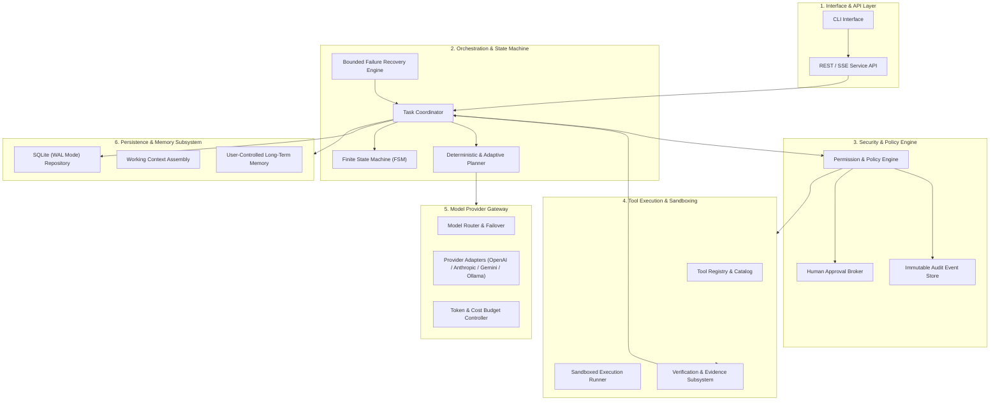
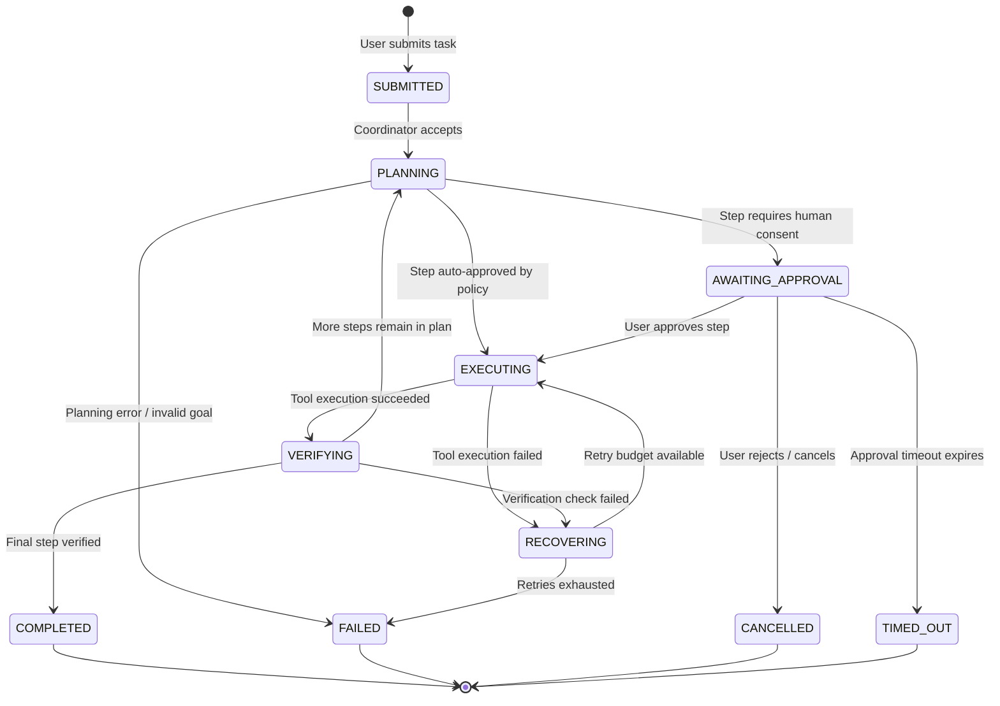
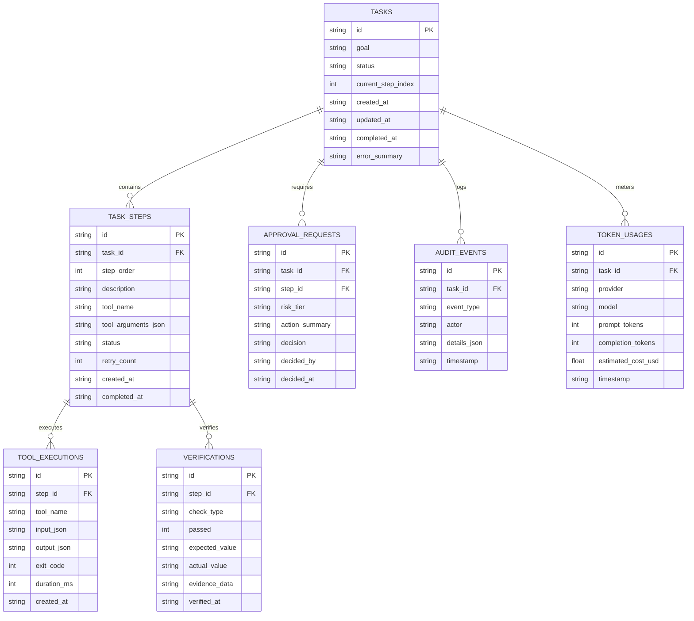

# Architecture Specification: Next-Generation Dots AI Platform

> **Document Status**: Approved Baseline (Phase 1)  
> **System Topology**: Modular Monolith  
> **Target Environment**: Windows 11 (8 GB RAM), Local-First, Zero-Infrastructure Overhead

---

## 1. High-Level Architectural Topology

The Dots AI Platform is designed as a **Modular Monolith**. This topology delivers strict logical decoupling, clear interface boundaries, and strong type safety without the process overhead, network latency, or operational complexity of microservices or container clusters.



---

## 2. Module Boundaries & Responsibilities

### 2.1 Interface & API Layer
- **Role**: Ingests commands, streams progress events to the user, and collects human approval decisions.
- **Components**:
  - `CLI Interface`: Minimal, zero-overhead terminal UI for running tasks, listing active/past tasks, and confirming approvals.
  - `API Service`: Express/Fastify HTTP server providing REST endpoints for task submission/control and Server-Sent Events (SSE) for real-time progress streaming.
- **Contract**: Accepts structured payloads (`TaskRequest`), validates with JSON schemas, and returns immediately with a durable `taskId` while execution runs asynchronously.

### 2.2 Orchestration & State Machine Engine
- **Role**: Coordinates the entire task lifecycle through a deterministic, crash-resilient Finite State Machine (FSM).
- **Components**:
  - `Task Coordinator`: Orchestrates the step sequence, evaluates preconditions, and dispatches instructions.
  - `Finite State Machine (FSM)`: Enforces valid state transitions and commits each transition to SQLite transactionally.
  - `Planner`: Breaks down complex tasks into bounded, directed acyclic graphs (DAGs) of discrete steps. Restricts max depth (default: 8 steps) to eliminate infinite planning loops.
  - `Bounded Recovery Engine`: Intercepts failures, applies exponential backoff, attempts alternative tools if permitted, and triggers safe termination when retry limits are exceeded.

### 2.3 Security, Policy & Approval Engine
- **Role**: Validates every proposed action against security rules and manages human-in-the-loop (HITL) approvals.
- **Components**:
  - `Policy Engine`: Classifies tool calls into Risk Tiers (Tier 0 to Tier 4). Enforces path jailing and parameter sanitization.
  - `Approval Broker`: Halts execution when an action requires human consent. Generates a cryptographic approval token, records the prompt, and suspends task state until explicit approval or rejection is received.
  - `Audit Event Store`: Appends every authorization check, tool invocation, human decision, and parameter diff to an append-only audit log.

### 2.4 Tool Execution & Sandboxing
- **Role**: Executes approved tools within restricted boundaries and collects tangible outputs.
- **Components**:
  - `Tool Registry`: Strongly typed catalog of available tools, their JSON parameter schemas, risk tiers, and execution handlers.
  - `Sandbox Runner`: Enforces working directory jailing (confined to configured workspace root), process isolation, execution timeouts, and memory limits.
  - `Verification Subsystem`: Validates expected side effects (file presence, checksums, exit codes, output schemas) before an action is certified as successful.

### 2.5 Model Provider Gateway
- **Role**: Decouples agent orchestration from specific LLM providers.
- **Components**:
  - `Provider Adapters`: Clean implementations for Google Gemini, Anthropic Claude, OpenAI-compatible APIs, and local Ollama instances.
  - `Model Router`: Selects models based on capability (reasoning vs fast extraction) and handles automatic failover.
  - `Cost & Token Budget Controller`: Meters input/output token usage per step, enforces per-task spending ceilings, and aborts execution before budget overruns occur.

### 2.6 Persistence & Memory Subsystem
- **Role**: Provides durable, low-footprint transactional storage and auditable memory.
- **Components**:
  - `SQLite Database (WAL Mode)`: Embedded, zero-configuration relational store using Write-Ahead Logging for high concurrency and immediate persistence.
  - `Working Context Manager`: Compiles prompt windows containing task goal, current step, prior step outputs, and relevant constraints.
  - `Long-Term Memory`: Key-value and structured fact store that allows users to view, search, export, edit, or delete any persisted memory item.

---

## 3. Finite State Machine (FSM) Specification

Every task follows a strict, deterministic state machine. No transition occurs in memory without an immediate database transaction.



### State Definitions & Persistence Guarantees
- **SUBMITTED**: Task recorded in SQLite. Initial parameters validated.
- **PLANNING**: Model is computing initial plan or adapting plan based on intermediate evidence.
- **AWAITING_APPROVAL**: Execution paused. System waiting for human input. Process can be safely terminated without losing state.
- **EXECUTING**: Tool is actively running inside the sandbox.
- **VERIFYING**: Tool finished; host asserts that side effects match expected criteria.
- **RECOVERING**: Failure detected. Evaluates retry count and triggers fallback or backoff.
- **COMPLETED**: All plan steps verified. Evidence package compiled.
- **FAILED**: Bounded limits reached, or fatal error encountered. Audit diagnostics saved.
- **CANCELLED**: Explicitly terminated by user. Running subprocesses killed.

---

## 4. End-to-End Request & Execution Lifecycle

The following sequence details how a task moves through the architecture:

```mermaid
sequenceDiagram
    autonumber
    actor User as User / Client
    participant API as API / CLI Layer
    participant TM as Task Coordinator
    participant DB as SQLite Storage
    participant LLM as Model Gateway
    participant Pol as Policy & Approval Engine
    participant Box as Sandbox & Tool Runner
    participant Ver as Verification Engine

    User->>API: Submit Task(goal, context, budget)
    API->>DB: INSERT Task (Status: SUBMITTED)
    API-->>User: Return TaskID (HTTP 202 / CLI Stream)

    TM->>DB: UPDATE Task (Status: PLANNING)
    TM->>LLM: GeneratePlan(goal, availableTools)
    LLM-->>TM: Return Plan (Step List & Tool Invocations)
    TM->>DB: INSERT TaskSteps(plan)

    loop For each TaskStep
        TM->>Pol: EvaluatePolicy(tool, parameters)
        alt High Risk (Requires Human Approval)
            Pol->>DB: UPDATE Task (Status: AWAITING_APPROVAL)
            Pol-->>User: ApprovalRequestedEvent(actionSummary, diff)
            User->>API: SubmitApproval(token, decision=APPROVED)
            API->>DB: Record Approval
        end

        TM->>DB: UPDATE Step (Status: EXECUTING)
        TM->>Box: ExecuteTool(toolName, sanitizedParams)
        Box-->>TM: ToolResult(stdout, exitCode, artifacts)
        TM->>DB: INSERT ToolExecutionRecord

        TM->>Ver: VerifyEvidence(stepId, expectedOutcome, artifacts)
        alt Evidence Valid
            Ver-->>TM: VerificationSuccess(evidencePayload)
            TM->>DB: UPDATE Step (Status: VERIFIED)
        else Evidence Invalid
            Ver-->>TM: VerificationFailure(mismatchDetails)
            TM->>DB: Trigger Recovery / Bounded Retry
        end
    end

    TM->>DB: UPDATE Task (Status: COMPLETED, evidenceSummary)
    TM-->>User: TaskCompletedNotification(finalOutput, evidence)
```

---

## 5. Storage Schema & Relational Data Model

The database uses SQLite with Write-Ahead Logging (`PRAGMA journal_mode=WAL;`). All foreign keys and strict constraints are enforced.



---

## 6. Durability, Crash Recovery & Idempotency

### 6.1 Crash Resiliency Guarantee
A core design objective is that killing the process (`SIGKILL`, Windows Task Manager termination, or power loss) leaves the database in a consistent, non-corrupted state.
- **WAL Mode**: Guarantees atomic commits and reader concurrency without blocking writes.
- **Step Idempotency**: Each tool execution step records an `idempotency_key = hash(task_id, step_order, tool_name, input_json)`. If a step is re-run during recovery, the sandbox checks whether the exact side effect already occurred before re-executing mutating logic.

### 6.2 Boot Recovery Routine
Upon startup, the Task Coordinator executes the reconciliation routine:
1. Scan `TASKS` table for entries with status `EXECUTING` or `PLANNING`.
2. For any task marked `EXECUTING`, inspect the latest `TASK_STEPS` entry:
   - If `TOOL_EXECUTIONS` contains a verified result, transition the step to `VERIFIED` and resume.
   - If `TOOL_EXECUTIONS` is incomplete or missing, mark the step as `INTERRUPTED`.
3. Check the step's retry budget:
   - If budget remains, mark state `RECOVERING` and schedule safe re-execution.
   - If budget exhausted, transition task to `FAILED` with diagnostic reason `PROCESS_TERMINATION_DURING_EXECUTION`.

---

## 7. Resource & Hardware Optimization (8 GB RAM Windows Target)

To operate comfortably on a Windows laptop with 8 GB RAM alongside typical developer tools (browsers, IDEs):

| Component | Architecture Technique | Memory Budget |
| :--- | :--- | :--- |
| **Node.js Runtime** | Single lightweight event loop, no heavy V8 heap bloat | 45 MB – 70 MB |
| **SQLite Storage** | In-process embedded engine, WAL mode, cache size capped at 16MB | 16 MB – 24 MB |
| **Active Task Memory** | Streaming tokens directly; bounded context buffers | 15 MB – 30 MB |
| **Process Sandboxing** | Ephemeral subprocess spawn with memory cap (`--max-old-space-size` / OS job object) | 50 MB max per child |
| **Total System Footprint** | Complete platform runs smoothly well under 180 MB peak | **~120 MB – 160 MB** |

- **No Always-On Containers**: Avoids the 2 GB+ overhead of Docker Desktop on Windows.
- **Zero Heavy Native Dependencies**: Relies on Node.js built-in primitives (`node:sqlite`, `node:test`, `node:crypto`, `node:fs`).

---

## 8. Future Compatibility Pathways

The architecture isolates modular extensions behind stable interfaces:
- **Scheduling & Cron**: An internal lightweight scheduler service can query `TASKS` for recurring definitions without altering the execution pipeline.
- **Multi-Agent Collaboration**: The `Task Coordinator` interface can accept sub-tasks routed to specialized sub-agents via standard message queues.
- **Voice / Audio Stream**: An audio ingestion adapter can transcribe speech into standard `TaskRequest` payloads and pipe streaming output to text-to-speech.
- **Cloud Migration**: Because the monolith is modular with strict repository interfaces, SQLite can be swapped for PostgreSQL and local process runners can be swapped for remote workers (e.g. AWS ECS or Fly.io) with zero changes to agent reasoning or policy logic.
