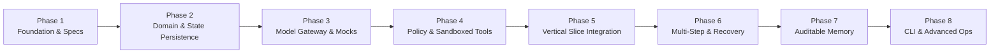

# Engineering Roadmap: Next-Generation Dots AI Platform

> **Document Status**: Approved Baseline (Phase 1)  
> **Development Model**: Incremental, Test-Driven, Phase-Gated

---

## 1. Roadmap Overview & Phasing Strategy

In accordance with Core Rule 4 (*"Do not generate the entire application in one pass. Work in small, reviewable, testable phases"*), development is divided into discrete, sequential milestones.

No phase begins until all preceding phase deliverables have been implemented, reviewed, and backed by passing automated test suites.

---

## 2. Phase-by-Phase Execution Plan

### Phase 1 — Architecture & Engineering Foundation (CURRENT)
- **Objective**: Establish the system boundaries, design documentation, threat models, architectural decisions, and acceptance contracts.
- **Key Deliverables**:
  - `README.md`
  - `docs/PRODUCT_VISION.md`
  - `docs/ARCHITECTURE.md`
  - `docs/SECURITY_MODEL.md`
  - `docs/ROADMAP.md`
  - `docs/DECISIONS.md`
  - `docs/ACCEPTANCE_CRITERIA.md`
- **Exit Criteria**: All planning files created and verified; workspace isolated from legacy projects; unresolved architecture decisions documented for user sign-off. Zero application code or dependencies installed.

---

### Phase 2 — Core Domain, State Machine & SQLite Persistence
- **Objective**: Build the transactional core of the platform without external dependencies.
- **Key Deliverables**:
  - TypeScript project initialization (`package.json`, `tsconfig.json`).
  - Core domain entity types (`Task`, `TaskStep`, `ToolExecution`, `AuditEvent`, `ApprovalRequest`).
  - SQLite database initializer with WAL mode (`db.ts`, DDL migrations).
  - Transactional Repository Layer (`TaskRepository`, `AuditRepository`).
  - Deterministic Finite State Machine (`TaskStateMachine`) with transition validation.
  - Comprehensive unit test suite (`tests/unit/fsm.test.ts`, `tests/unit/repo.test.ts`) using native `node:test`.
- **Exit Criteria**: 100% passing tests for state transitions, invalid transition rejections, and atomic persistence across database connections.

---

### Phase 3 — Provider-Agnostic Model Gateway & Mock/Local Adapter
- **Objective**: Decouple model reasoning from vendor SDKs and provide an offline testing harness.
- **Key Deliverables**:
  - `IModelProvider` interface definition for chat and structured tool calling.
  - `MockModelProvider` for deterministic, zero-cost, offline unit and integration tests.
  - `GeminiProvider` and `OpenAICompatibleProvider` concrete adapters.
  - Token and cost tracking middleware with per-task budget ceiling enforcement.
  - Prompt compiler with automated secret scrubbing filter.
  - Unit tests verifying provider switching, cost bounds, and secret redaction.
- **Exit Criteria**: Model gateway successfully issues tool requests against both mock and live adapters; secret scrubber redacts simulated API keys; token counters accurately track usage.

---

### Phase 4 — Policy Engine, Tool Registry & Sandboxed Execution
- **Objective**: Implement strict tool isolation, permission enforcement, and human approval brokers.
- **Key Deliverables**:
  - `ToolRegistry` with strongly-typed schemas and risk tier tags (Tier 0 to Tier 4).
  - Baseline sandboxed tools: `file_read`, `file_write`, `calculate`, `hash_file`.
  - `PolicyEngine` enforcing canonical workspace path jailing and path traversal blocks.
  - `ApprovalBroker` for generating and verifying cryptographic approval tokens.
  - `ImmutableAuditStore` writing append-only event records to SQLite.
  - Unit tests verifying path traversal prevention (`../../evil.txt`), unauthorized tool blocks, and approval gating.
- **Exit Criteria**: All path traversal attempts throw security exceptions; Tier 3/4 operations reliably pause task state until approved; audit log records every attempt.

---

### Phase 5 — First Complete Vertical Slice Integration
- **Objective**: Connect the layers into a demonstrable, end-to-end operational pipeline.
- **Scenario**: User submits a task -> Backend persists it -> Agent plans and invokes 1 explicitly allowed sandboxed tool -> Result is independently verified with cryptographic evidence -> Completed task state is retrieved after an abrupt simulated process restart.
- **Key Deliverables**:
  - `TaskCoordinator` connecting API, FSM, Model Gateway, Policy Engine, and Sandbox.
  - `VerificationSubsystem` asserting tangible side effects (file existence and hash).
  - Crash recovery reconciliation logic on engine startup.
  - End-to-end integration test (`tests/e2e/vertical_slice.test.ts`).
- **Exit Criteria**: Full execution of the vertical slice test passes reliably; database cleanly rehydrates state after restart; zero data loss.

---

### Phase 6 — Extended Tooling, Multi-Step Workflows & Bounded Recovery
- **Objective**: Enable complex multi-step workflows with autonomous self-healing and safety limits.
- **Key Deliverables**:
  - DAG plan executor supporting multi-step dependencies (up to 8 steps).
  - Bounded retry engine with exponential backoff and jitter.
  - Fallback tool routing and dynamic re-planning on step failure.
  - Hard loop-prevention circuit breakers (max retries, max steps, token budget caps).
  - Compensation / rollback routines for partially failed mutations.
- **Exit Criteria**: System successfully navigates multi-step workflows; handles injected step errors via bounded recovery; cleanly halts and records diagnostics if recovery fails.

---

### Phase 7 — User-Controlled Long-Term Memory & Context Management
- **Objective**: Equip the agent with durable knowledge while maintaining complete user sovereignty and transparency.
- **Key Deliverables**:
  - Structured memory schema (id, key, category, value, source, confidence, timestamp).
  - User memory management API (create, read, search, edit, delete, export).
  - Working context window manager with token-budgeted pruning.
  - Integration tests verifying memory retrieval and complete deletion verification.
- **Exit Criteria**: Users can audit and purge memories with immediate effect; memory injections stay within prompt token budgets.

---

### Phase 8 — User Interface (CLI & Web Dashboard) & Advanced Capabilities
- **Objective**: Deliver a polished, ergonomic interface for daily use on the 8 GB Windows laptop.
- **Key Deliverables**:
  - Interactive Terminal CLI (`dots run`, `dots status`, `dots approve`, `dots memory`).
  - Lightweight local web interface (vanilla JS or lightweight Preact/Svelte, <10 MB asset bundle).
  - Background task scheduling (cron-compatible lightweight timer).
  - Comprehensive documentation and operational guide.
- **Exit Criteria**: Full end-to-end user workflows executed via CLI and Web UI with peak memory consumption strictly below 180 MB RAM.
