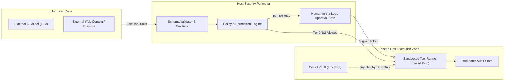

# Security Architecture & Trust Model

> **Document Status**: Approved Baseline (Phase 1)  
> **Classification**: Core Safety & Isolation Policy  
> **Primary Mandate**: Zero Unrestricted Access; Host Enforcement of All Boundaries

---

## 1. Threat Model & Trust Boundaries

The fundamental axiom of the Dots AI Platform is that **the AI model is an untrusted entity**. Model outputs cannot be trusted to self-police, correctly gauge security implications, or protect system integrity.



### Threat Vectors Addressed:
1. **Indirect Prompt Injection**: Data ingested from external files or web content containing hidden instructions designed to trick the model into executing unauthorized commands.
2. **Path Traversal & Arbitrary File Overwrites**: Attempts to write files outside the designated workspace using `../` sequences, symlinks, or absolute system paths (`C:\Windows\...`).
3. **Runaway Resource Consumption**: Infinite loops, excessive memory allocations, or unbounded API calls draining financial budgets or crashing the 8 GB host system.
4. **Secret Exfiltration**: Prompts designed to coax the model into reading `.env` files, environment variables, or printing API keys into outputs or logs.
5. **Arbitrary Code Execution**: Unrestricted shell execution allowing arbitrary PowerShell or bash command execution.

---

## 2. Risk Classification & Permission Tiers

Every capability exposed to the agent is registered with an immutable **Risk Tier**. Permissions are enforced in trusted host code before tool execution begins:

| Tier | Classification | Description | Default Policy | Human Approval Required? |
| :---: | :--- | :--- | :--- | :---: |
| **Tier 0** | **Pure Computation** | Deterministic in-memory transforms (math, text formatting, JSON parsing). Zero filesystem or network access. | `AUTO_ALLOW` | **No** |
| **Tier 1** | **Read-Only Inspection** | Reading files strictly inside the jailed workspace; inspecting task state; querying registry. | `AUTO_ALLOW` | **No** |
| **Tier 2** | **Reversible Mutation** | Writing, updating, or creating files strictly inside the jailed `scratch/` workspace directory. | `AUTO_ALLOW` (with path check) | **No** (unless flagged by rule) |
| **Tier 3** | **Consequential Action** | Outbound HTTP requests to approved domains; executing whitelisted static scripts; writing files outside scratch. | `POLICY_CHECK` | **Yes (Default)** |
| **Tier 4** | **Destructive / System** | Deleting files; executing system commands; modifying platform configuration or credentials. | `RESTRICTED` | **Mandatory Human Sign-off** |

---

## 3. Sandboxing & Filesystem Jailing

### 3.1 Strict Directory Jailing
All file tools (`file_read`, `file_write`, `file_list`, `hash_file`) execute against a strictly resolved canonical workspace root:

```
Configured Root: C:\Users\Dell\.gemini\antigravity\scratch\dots-platform\sandbox\
```

- **Path Canonicalization**: All requested paths are resolved via `path.resolve()` and tested with `path.relative()`.
- **Traversal Prevention**: If the resolved relative path starts with `..` or is an absolute drive path outside the root, the execution is blocked immediately with a `SECURITY_VIOLATION_PATH_TRAVERSAL` error.
- **Symlink Resolution**: Symlinks pointing outside the workspace jail are rejected during canonicalization.

### 3.2 Subprocess & Shell Isolation
- **No Arbitrary Shell Passing**: The platform never calls `exec("powershell -Command " + userInput)` or `cmd.exe /c`.
- **Strict Executable Whitelist**: Only pre-registered, explicitly approved executables can be invoked via `child_process.spawn()` with structured argument arrays.
- **Resource Limits**:
  - **Timeout Bound**: Hard ceiling of 15,000 ms per tool invocation. Processes exceeding this are terminated via `SIGKILL`.
  - **Output Buffer Limit**: Standard output and error buffers are capped at 512 KB. Excessive output is truncated to prevent heap exhaustion.
  - **Memory Limits**: Child processes are spawned with bounded memory flags where applicable.

---

## 4. Human-in-the-Loop (HITL) Approval Architecture

When an action triggers Tier 3 or Tier 4 classification, the orchestrator suspends execution:

1. **Approval Request Generation**:
   - The coordinator generates an immutable `ApprovalRequest` record containing:
     - `approval_token`: High-entropy UUIDv4.
     - `action_summary`: Plain-English summary of what is about to happen.
     - `target_resource`: File path, URL, or command string.
     - `parameter_diff`: Exact parameters proposed by the agent.
     - `expires_at`: Timestamp (default: 5 minutes expiration).
2. **Task State Suspension**:
   - Task state transitions to `AWAITING_APPROVAL`.
   - The task can safely remain in this state even across application reboots.
3. **User Presentation & Decision**:
   - The CLI or API presents the exact action, diff, and safety tier.
   - The user must explicitly submit `APPROVED` or `REJECTED`.
4. **Resumption or Rollback**:
   - If `APPROVED`: The signed token is validated by the execution engine, and the step proceeds.
   - If `REJECTED`: The step transitions to `REJECTED`, and the agent planner is informed with feedback to formulate an alternative plan.

---

## 5. Secret Management & Credential Scrubbing

### 5.1 Zero Secrets in Source & Version Control
- All API keys (e.g. `GEMINI_API_KEY`, `OPENAI_API_KEY`, `ANTHROPIC_API_KEY`) are loaded solely through environment variables or a local `.env` file that is strictly ignored by version control.
- No secrets are ever committed, hardcoded, or stored in database tables.

### 5.2 Secret Masking in Context and Logs
The logging subsystem and model prompt compiler run all strings through a **Secret Scrubbing Filter** before writing to disk or sending over the wire:
- Scrubbing regexes identify API key patterns:
  - Google AI keys: `AIza[0-9A-Za-z\\-_]{35}`
  - OpenAI keys: `sk-[a-zA-Z0-9_-]{20,}`
  - Anthropic keys: `sk-ant-[a-zA-Z0-9_-]{20,}`
  - Generic Bearer tokens: `Bearer\s+[A-Za-z0-9\-._~+/]+=*`
- Matched patterns are replaced with `[REDACTED_SECRET]`.
- The agent prompt compiler never receives the host machine's environment variables or credential stores.

---

## 6. Immutable Audit Trail & Verification Logs

Every consequential event is logged to an append-only `AUDIT_EVENTS` table in SQLite:
- **Event Structure**:
  - `event_id`: Unique identifier.
  - `task_id`: Associated task.
  - `timestamp`: High-precision UTC timestamp.
  - `actor`: `USER`, `AGENT`, `POLICY_ENGINE`, or `SYSTEM`.
  - `action`: E.g., `TOOL_CALL_PROPOSED`, `POLICY_EVALUATED`, `APPROVAL_GRANTED`, `EXECUTION_COMPLETED`, `VERIFICATION_FAILED`.
  - `payload_hash`: SHA-256 hash of the input/output payload ensuring non-repudiation.
  - `details_json`: Structured context.

The audit log is permanent, surviving application restarts, and provides complete post-incident forensic visibility.
